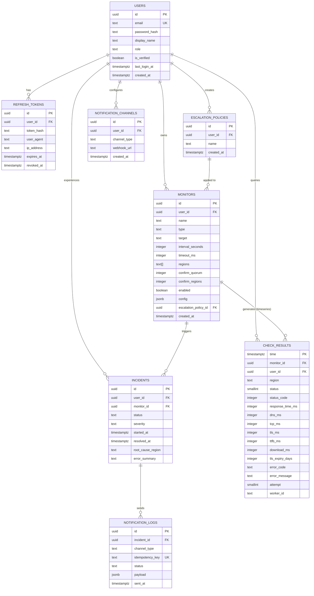

# API Pulse Database Schema

Below is the complete Entity Relationship Diagram (ERD) mapping the PostgreSQL database schema for the API Pulse project, followed by a breakdown of table normalization.

## Entity Relationship Diagram (Mermaid)

## Normalization Strategy & Analysis

The PostgreSQL schema is highly optimized, striking a perfect balance between **Third Normal Form (3NF)** for operational configuration data and **Dimensional Denormalization** for the high-throughput time-series data.

### 1. 3NF (Third Normal Form) Configurations
All configuration tables (`users`, `monitors`, `escalation_policies`, `notification_channels`) are strictly normalized to 3NF.
*   **Atomicity (1NF):** Each column holds atomic values. (The `regions` array in `monitors` is a deliberate PostgreSQL `TEXT[]` optimization for simple enumerable settings, avoiding an unnecessary junction table for what is effectively a list of static enums).
*   **No Partial Dependencies (2NF):** Every non-key attribute is fully dependent on the primary key (UUIDs). For example, `webhook_url` is fully dependent on the `notification_channels` ID, not on the user.
*   **No Transitive Dependencies (3NF):** A user's configuration for alerts is segregated. Instead of putting `escalation_policy` details directly into the `monitors` table, they are isolated in `escalation_policies`, and the `monitors` table merely holds a Foreign Key (`escalation_policy_id`). This ensures that updating a policy cascades automatically to all monitors using it.

### 2. Time-Series Denormalization (The Fact Table)
The `check_results` table operates as a **Fact Table** in a data warehouse pattern, managed as a **TimescaleDB Hypertable**.
*   It includes a `user_id` column, even though it already has a `monitor_id` column (which links to the `user_id`). 
*   **Why?** In a strictly normalized database, you would JOIN `check_results` to `monitors` to filter metrics by `user_id`. However, because `check_results` ingests hundreds of millions of rows, running a `JOIN` on every single dashboard load would bottleneck the database. By intentionally denormalizing `user_id` into the fact table, we allow incredibly fast B-Tree indexing (`idx_check_results_user_time`) so the dashboard API can instantly pull a user's stats natively.

### 3. Separation of State (Auditing vs. Action)
*   **`incidents` vs `notification_logs`**: When an outage occurs, it opens an incident. Rather than storing boolean flags like `slack_sent = true` on the incident (which violates normalization if you add new channels like SMS or Email later), we created a distinct `notification_logs` table (One-to-Many). This allows infinite notification channels to be audited perfectly without altering the `incidents` table structure.
